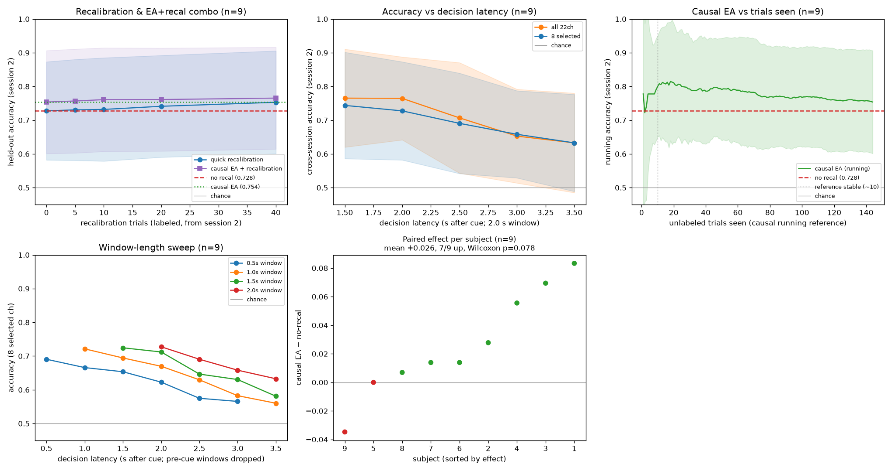

# MyEEG

**Can a few well-chosen EEG electrodes decode motor imagery as well as a full cap — and keep working day to day?**

This project studies personalized, task-aware EEG channel selection for brain-computer interfaces, on left- vs right-hand motor imagery. It is software only: it works from public, already-recorded EEG and asks two questions in order.

- **Part 1 — channel selection.** Can a small, personalized channel subset match a full-cap decoder? Answer: **yes for accuracy, no for stability.** Eight selected channels match the 22-channel accuracy, but the *best* channels drift from one session (day) to the next.
- **Part 2 — online decoding and quick recalibration.** Since the best channels drift, can a small channel set fixed on day 1 be *recalibrated quickly* on day 2 and still decode **causally, online**? This part adds a sliding-window causal decoder, a recalibration-vs-trials sweep, and a Euclidean-alignment transfer baseline.

Two classes only. BCI IV 2a has four (left hand, right hand, feet, tongue); everything here uses the **left/right two-class subset**, and that is stated wherever a number is reported.

## Headline result



*(Part 2 figure — produced by `online/run_online.py` then `online/plot_online.py`. See "Reproduce Part 2".)*

The settled Part 1 figure (accuracy vs channel count, cross-session) is `results/bnci_fbcsp.png`.

---

## Part 1 — channel selection (frozen as tag `v1-channel-selection`)

The exact v1 numbers live in [`docs/results-summary.md`](docs/results-summary.md) and `results/`. Nothing in Part 2 edits the Part 1 scripts, so these numbers do not silently change. Checkout `git checkout v1-channel-selection` to reproduce the original state.

Key findings on BCI IV 2a (9 subjects, 2 sessions on different days, 144 left/right trials/session, 22 channels), FBCSP + CSP decoder, no leakage (channels and models fit on training trials only):

- **8 channels match 22.** Cross-session (train day 1, test day 2): 8ch 0.777 vs all-22 0.772; 16ch 0.796; 4ch 0.761. Fewer channels barely cost accuracy.
- **Best channels drift.** Greedy picks on day 1 and day 2 overlap no better than chance, and the region test shows the drift is geometric, not just neighbour-swapping. So a fixed-forever placement degrades — the design answer is fixed electrodes over the motor region with redundancy, plus a decoder re-trained each session.
- Deep models (EEGNet, DANN, pooled) were tried on Colab and **all lost to CSP** (0.721 / 0.718 / 0.728 vs 0.772); see `docs/results-summary.md`.

Scripts: `baseline.py`, `select_channels.py`, `fast_csp.py`, `fbcsp.py`, `fbcsp_select.py`, `bnci_*.py`. Figures: `results/bnci_fbcsp.png`, `results/bnci_cross_session.png`, `results/bnci_region_test.png`.

### Reproduce Part 1

```powershell
py -3.12 -m venv .venv
.\.venv\Scripts\Activate.ps1
pip install -r requirements.txt
# BCI IV 2a downloads automatically via MOABB into data/ on first run (see "Data").
python bnci_fbcsp.py          # ~67 min; writes results/bnci_fbcsp_results.json
python bnci_fbcsp_plot.py     # draws results/bnci_fbcsp.png from that JSON
python -m pytest tests/ -v    # no-leakage + CovCSP-matches-MNE checks
```

---

## Part 2 — online decoding and quick recalibration (`online/`)

New work, kept in its own package so the Part 1 numbers above never move. It answers: *given that the best channels drift, can a day-1 channel set recover on day 2 with a short, labeled warm-up, decoding causally and online?*

**Honest-evaluation contract** (enforced by `tests/test_online.py`):

- **Causal.** A decision at time *t* uses only samples at or before *t*. A sliding window looks backward only; future samples are never read. Accuracy is reported as a function of **decision latency** (time since cue).
- **No test-session leakage.** Channels are selected on **session 1 only**; session 2 is the stream.
- **Recalibration is held out.** The *k* labeled recalibration trials are removed from the test set, so no trial is both trained on and scored.
- **Transfer baseline uses no labels.** Euclidean alignment (He & Wu, 2020) aligns sessions using only the **unlabeled** incoming covariances — a fair, well-known cheap baseline.

Modules:

- `online/causal_decoder.py` — causal sliding-window CSP+LR; accuracy vs decision latency.
- `online/euclidean_alignment.py` — Euclidean-alignment transfer baseline (zero labels).
- `online/recalibration.py` — accuracy vs number of recalibration trials (0/5/10/20/40), three conditions: no-recal, EA, quick recalibration.
- `online/run_online.py` — runs both sweeps over 9 subjects, measures per-decision compute latency, writes `results/online_results.json`.
- `online/plot_online.py` — draws `results/online_recalibration.png` from that JSON (recomputes nothing).
- `online/replay_demo.py` — causal replay demo: streams session 2 window by window and shows live left/right predictions.

### Results

> **Status: the 9-subject sweep has not been run yet on this machine.** The code,
> tests, and plotting are complete and verified on synthetic data, but
> `results/online_results.json` and `results/online_recalibration.png` are
> produced by `online/run_online.py`, which needs MOABB/MNE and more memory than
> the current host has free. **No Part 2 accuracy numbers are quoted until that run
> exists** — this section will be filled with the real means (no-recal, EA,
> recal@{5,10,20,40}, and decode latency in ms) from the committed JSON.

### Reproduce Part 2

```powershell
.\.venv\Scripts\Activate.ps1
python -m online.run_online        # writes results/online_results.json (all 9 subjects)
python -m online.plot_online       # draws results/online_recalibration.png from the JSON
```

Replay demo (runs from the lightweight `.npz` exports — no MOABB load needed):

```powershell
python export_for_colab.py                 # one-time: writes export_npz/sub*_{T,E}.npz
python -m online.replay_demo --subject 1          # terminal: streaming left/right calls
python -m online.replay_demo --subject 1 --plot   # live arrow window
python -m online.replay_demo --subject 1 --recal 20   # warm up on 20 session-2 trials first
```

---

## Data

BCI Competition IV dataset 2a (BNCI2014_001). It is **not redistributed here** — it downloads automatically on first run via MOABB into the gitignored `data/` folder (the loader sets `MNE_DATASETS_BNCI_PATH` to `data/` for this process only). Dataset home: <https://www.bbci.de/competition/iv/#dataset2a>, served through MOABB (<https://neurotechx.github.io/moabb/>). The 9 subjects × 2 sessions are ~1.6 GB on first download.

The older PhysioNet pilot (`load_data.py`, EEG Motor Movement/Imagery, <https://physionet.org/content/eegmmidb/1.0.0/>) decoded clearly on only 3 of 10 subjects and is kept for history; BCI IV 2a is the dataset the results rest on.

## Environment

Pinned in [`requirements.txt`](requirements.txt): Python 3.12, `mne`, `numpy`, `scipy`, `scikit-learn`, `matplotlib`, `moabb`, `pytest`. `pylsl` is only for the optional real-time LSL stub (`streamer.py`). No GPU is needed for any of Part 1 or Part 2; the Colab deep-model work (`colab_deep_model.py`) is the only GPU piece and is separate.

## Docs

- [`docs/results-summary.md`](docs/results-summary.md): full Part 1 + deep-model results with every number.
- [`docs/deep-model-plan.md`](docs/deep-model-plan.md): the parked deep-model (drift-tolerance) plan.
- [`AGENTS.md`](AGENTS.md): project vision, research question, pipeline, evaluation rules.
